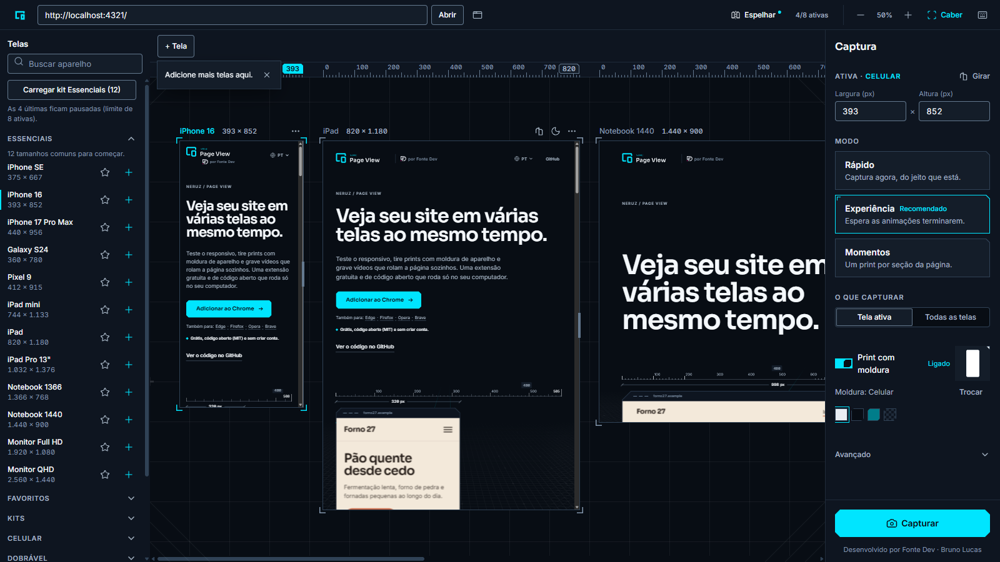

<p align="center">
  <a href="README.md">🇧🇷 Português</a> · <b>🇺🇸 English</b> · <a href="README.es.md">🇪🇸 Español</a>
</p>

<p align="center">
  
</p>

<p align="center">
  <a href="LICENSE"></a>
</p>

<p align="center">
  <a href="https://pageview.neruz.tech"><b>Website</b></a> ·
  <a href="#install">Install</a> ·
  <a href="#how-it-works">How it works</a> ·
  <a href="#who-its-for">Use cases</a> ·
  <a href="#privacy-and-permissions">Privacy</a> ·
  <a href="#development">Development</a>
</p>

---

**Neruz Page View** brings together what usually takes three or four extensions: see a site on many screen sizes side by side, browse all of them at once, and walk away with a screenshot, video or mockup ready to show a client or post.

It is **free forever**, **open source (MIT)** and runs **100% on your computer**. No account, no server, no hidden paid tier.

<p align="center">
  
</p>

## Install

| Browser              | Where                                          |
| -------------------- | ---------------------------------------------- |
| Chrome, Brave, Opera | Chrome Web Store (in review, link coming soon) |
| Edge                 | Edge Add-ons (coming soon)                     |
| Firefox 128+         | Firefox Add-ons (coming soon)                  |

### Preview build, available now

1. Download: **[Chrome, Edge, Brave and Opera](../../releases/download/v1.0.0-beta.1/neruz-page-view-1.0.0-chrome.zip)** or **[Firefox](../../releases/download/v1.0.0-beta.1/neruz-page-view-1.0.0-firefox.zip)**.
2. Unzip it into a folder you won't delete.
3. **Chrome/Edge/Brave/Opera:** open `chrome://extensions` (on Edge, `edge://extensions`), turn on **Developer mode** and click **Load unpacked**, picking the folder.
   **Firefox:** open `about:debugging#/runtime/this-firefox`, click **Load Temporary Add-on** and pick the folder's `manifest.json`.
4. Pin the icon from the puzzle piece next to the address bar and click it (or press `Alt+Shift+P`) on any site to open the **Studio**.

All versions: [Releases](../../releases).

## How it works

1. **Open the Studio** from any tab. The page shows up in a starter set of screens.
2. **Build your screens**: 46 devices in the library (phone, foldable, tablet, laptop, desktop, TV), favorites, saved kits and screens of any size you want. Rotate, drag to resize, zoom, or hit **Fit**.
3. **Browse all of them at once**: with **Mirror** on, scrolling, clicks, navigation and typing on one screen repeat on the others.
4. **Capture**:
   - **Screenshot**: _Quick_ (as it is), _Experience_ (waits for scroll animations to finish) or _Moments_ (one shot per section). From the active screen, all screens or many pages.
   - **Framed screenshot**: the shot comes out inside a device frame on the background you choose. The frame shows live on the active screen before you capture.
   - **Video**: the page scrolls by itself, pauses at each section, and exports as vertical 1080×1920, square, 16:9 or screen size. A mini bar controls pause and speed while recording.
   - **Many pages**: a URL list, sitemap or internal links, queued, with an organized ZIP and an HTML report.
5. **Export** as PNG, JPEG, WebP, PDF, MP4, WebM, GIF or ZIP.

## Who it's for

- **Front-end devs**: check responsiveness in one go, catch horizontal scroll (the extension flags it) and test `localhost`.
- **Designers**: review hierarchy across sizes and make mockups without opening another app.
- **Agencies and freelancers**: hand clients framed screenshots and a capture report covering every page.
- **Social media folks and non-technical users**: turn a website into a vertical video for Reels and Stories in two clicks.

## Privacy and permissions

Nothing leaves your computer. The extension has no server, no analytics and collects no data. Settings live in the browser's local storage. Full policy: [pt-BR](docs/PRIVACIDADE.md) · [en](docs/PRIVACIDADE.en.md) · [es](docs/PRIVACIDADE.es.md).

| Permission                                | Why                                                                                                     |
| ----------------------------------------- | ------------------------------------------------------------------------------------------------------- |
| `activeTab`, `scripting`                  | Read the page you opened in the Studio and mirror actions across screens                                |
| `declarativeNetRequestWithHostAccess`     | Let sites load inside the Studio's screens. Applies only to Studio tabs and is undone when you close it |
| `storage`                                 | Keep your screens, kits and preferences locally                                                         |
| `offscreen`                               | Record video in the background (Chromium)                                                               |
| Site access (optional)                    | Requested per site, only when you open that site in the Studio                                          |
| `tabCapture`, `clipboardWrite` (optional) | Record video and copy the screenshot, requested only on first use                                       |

## Development

Requirements: Node 22.23+ and pnpm 12.

```bash
pnpm install
pnpm dev:ext            # extension in dev mode (Chrome)
pnpm dev:landing        # website at http://localhost:4321
pnpm build:ext          # apps/page-view/.output/chrome-mv3
pnpm build:ext:firefox  # apps/page-view/.output/firefox-mv3
pnpm lint && pnpm typecheck && pnpm test
```

| Folder             | Contents                                  |
| ------------------ | ----------------------------------------- |
| `apps/page-view`   | Extension (WXT, React, TypeScript)        |
| `apps/landing`     | Website (Astro)                           |
| `packages/core`    | Messaging, storage, page queue and report |
| `packages/capture` | Image capture and video recording         |
| `packages/devices` | Device library                            |
| `packages/i18n`    | pt-BR, en, es translations                |
| `packages/ui`      | Design tokens, frames and components      |

Architecture, internal contracts and decisions (in Portuguese): [ARQUITETURA](docs/ARQUITETURA.md) · [API](docs/API.md) · [DECISOES](docs/DECISOES.md) · [DESIGN SYSTEM](docs/DESIGN-SYSTEM.md).

## Contributing

Issues and pull requests are welcome. Before opening a PR, run `pnpm lint && pnpm typecheck && pnpm test`. For big changes, open an issue first so we can talk it through.

## License

[MIT](LICENSE). Use, study, modify and share it freely, including in commercial projects, as long as you keep the copyright notice.

## The Neruz family

Page View is the first extension from **Neruz Extensions**, a family of tools for people who build on the web. More soon at [neruz.tech](https://neruz.tech).

---

<p align="center">
  <a href="https://fontedev.com/links/"></a>
</p>
