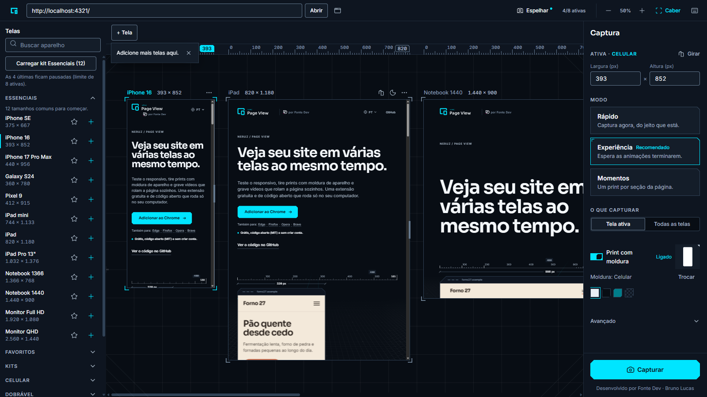

<p align="center">
  <a href="README.md">🇧🇷 Português</a> · <a href="README.en.md">🇺🇸 English</a> · <b>🇪🇸 Español</b>
</p>

<p align="center">
  
</p>

<p align="center">
  <a href="LICENSE"></a>
</p>

<p align="center">
  <a href="https://pageview.neruz.tech"><b>Sitio</b></a> ·
  <a href="#instalar">Instalar</a> ·
  <a href="#cómo-funciona">Cómo funciona</a> ·
  <a href="#para-quién-es">Casos de uso</a> ·
  <a href="#privacidad-y-permisos">Privacidad</a> ·
  <a href="#desarrollo">Desarrollo</a>
</p>

---

**Neruz Page View** reúne en una sola extensión lo que hoy pide tres o cuatro: ver un sitio en varios tamaños de pantalla lado a lado, navegar en todos a la vez y salir con una captura, un video o un mockup listo para mostrarle al cliente o publicar.

Es **gratis para siempre**, **de código abierto (MIT)** y funciona **100% en tu computadora**. Sin cuenta, sin servidor y sin versión de pago escondida.

<p align="center">
  
</p>

## Instalar

| Navegador            | Dónde                                         |
| -------------------- | --------------------------------------------- |
| Chrome, Brave, Opera | Chrome Web Store (en revisión, enlace pronto) |
| Edge                 | Edge Add-ons (pronto)                         |
| Firefox 128+         | Firefox Add-ons (pronto)                      |

### Versión de prueba, ya disponible

1. Descarga el archivo: **[Chrome, Edge, Brave y Opera](../../releases/download/v1.0.0-beta.1/neruz-page-view-1.0.0-chrome.zip)** o **[Firefox](../../releases/download/v1.0.0-beta.1/neruz-page-view-1.0.0-firefox.zip)**.
2. Descomprime el `.zip` en una carpeta que no vayas a borrar.
3. **Chrome/Edge/Brave/Opera:** abre `chrome://extensions` (en Edge, `edge://extensions`), activa el **Modo de desarrollador** y haz clic en **Cargar descomprimida**, eligiendo la carpeta.
   **Firefox:** abre `about:debugging#/runtime/this-firefox`, haz clic en **Cargar complemento temporal** y elige el `manifest.json` de la carpeta.
4. Fija el ícono desde la pieza de rompecabezas junto a la barra de direcciones y haz clic en él (o `Alt+Shift+P`) en cualquier sitio para abrir el **Estudio**.

Todas las versiones: [Releases](../../releases).

## Cómo funciona

1. **Abre el Estudio** desde cualquier pestaña. La página aparece en un kit inicial de pantallas.
2. **Arma tus pantallas**: 46 dispositivos en la biblioteca (celular, plegable, tablet, laptop, escritorio, TV), favoritos, kits guardados y pantallas del tamaño que quieras. Gira, cambia el tamaño arrastrando, ajusta el zoom o usa **Ajustar**.
3. **Navega en todas a la vez**: con **Reflejar** activado, el desplazamiento, los clics, la navegación y lo que escribes en una pantalla se repiten en las demás.
4. **Captura**:
   - **Captura**: _Rápida_ (tal como está), _Experiencia_ (espera a que terminen las animaciones de scroll) o _Momentos_ (una captura por sección). De la pantalla activa, de todas o de varias páginas.
   - **Captura con marco**: la imagen sale dentro de un marco de dispositivo con el fondo que elijas. El marco aparece en vivo en la pantalla activa antes de capturar.
   - **Video**: la página se desplaza sola, hace una pausa en cada sección y sale en vertical 1080×1920, cuadrado, 16:9 o al tamaño de la pantalla. Una mini barra controla la pausa y la velocidad durante la grabación.
   - **Varias páginas**: lista de URLs, sitemap o enlaces internos, en cola, con ZIP organizado e informe HTML.
5. **Exporta** en PNG, JPEG, WebP, PDF, MP4, WebM, GIF o ZIP.

## Para quién es

- **Dev front-end**: revisar el responsive de una vez, detectar scroll horizontal (la extensión avisa) y probar `localhost`.
- **Diseñador**: revisar la jerarquía en varios tamaños y generar mockups sin abrir otro programa.
- **Agencias y freelancers**: entregar al cliente capturas con marco y un informe de todas las páginas.
- **Social media y quien no es técnico**: convertir un sitio en un video vertical para Reels y Stories en dos clics.

## Privacidad y permisos

Las capturas, los videos y las páginas que ves se quedan en tu computadora. La extensión no tiene servidor propio y no pide cuenta. Envía estadísticas anónimas de uso a Google Analytics 4: un identificador aleatorio, la versión y qué herramientas se usaron, sin dirección de página, contenido ni capturas. Puedes desactivarlo en las opciones (en Firefox solo envía si aceptas el permiso opcional). La configuración queda en el almacenamiento local del navegador. Política completa: [pt-BR](docs/PRIVACIDADE.md) · [en](docs/PRIVACIDADE.en.md) · [es](docs/PRIVACIDADE.es.md).

| Permiso                                     | Para qué                                                                                                                                  |
| ------------------------------------------- | ----------------------------------------------------------------------------------------------------------------------------------------- |
| `activeTab`, `scripting`                    | Leer la página que abriste en el Estudio y reflejar las acciones entre pantallas                                                          |
| `declarativeNetRequestWithHostAccess`       | Permitir que los sitios se muestren dentro de las pantallas del Estudio. Vale solo para las pestañas del Estudio y se deshace al cerrarlo |
| `storage`                                   | Guardar tus pantallas, kits y preferencias localmente                                                                                     |
| `offscreen`                                 | Grabar el video en segundo plano (Chromium)                                                                                               |
| Acceso a sitios (opcional)                  | Se pide sitio por sitio, solo cuando abres ese sitio en el Estudio                                                                        |
| `tabCapture`, `clipboardWrite` (opcionales) | Grabar video y copiar la captura, se piden solo la primera vez                                                                            |

## Desarrollo

Requisitos: Node 22.23+ y pnpm 12.

```bash
pnpm install
pnpm dev:ext            # extensión en modo desarrollo (Chrome)
pnpm dev:landing        # sitio en http://localhost:4321
pnpm build:ext          # apps/page-view/.output/chrome-mv3
pnpm build:ext:firefox  # apps/page-view/.output/firefox-mv3
pnpm lint && pnpm typecheck && pnpm test
```

| Carpeta            | Contenido                                             |
| ------------------ | ----------------------------------------------------- |
| `apps/page-view`   | Extensión (WXT, React, TypeScript)                    |
| `apps/landing`     | Sitio de presentación (Astro)                         |
| `packages/core`    | Mensajería, almacenamiento, cola de páginas e informe |
| `packages/capture` | Captura de imagen y grabación de video                |
| `packages/devices` | Biblioteca de dispositivos                            |
| `packages/i18n`    | Traducciones pt-BR, en, es                            |
| `packages/ui`      | Design tokens, marcos y componentes                   |

Arquitectura, contratos internos y decisiones (en portugués): [ARQUITETURA](docs/ARQUITETURA.md) · [API](docs/API.md) · [DECISOES](docs/DECISOES.md) · [DESIGN SYSTEM](docs/DESIGN-SYSTEM.md).

## Contribuir

Los issues y pull requests son bienvenidos. Antes de abrir un PR, ejecuta `pnpm lint && pnpm typecheck && pnpm test`. Para cambios grandes, abre primero un issue para conversarlo.

## Licencia

[MIT](LICENSE). Úsalo, estúdialo, modifícalo y compártelo libremente, incluso en proyectos comerciales, manteniendo el aviso de copyright.

## La familia Neruz

Page View es la primera extensión de **Neruz Extensions**, una familia de herramientas para quienes construyen en la web. Más pronto en [neruz.tech](https://neruz.tech).

---

<p align="center">
  <a href="https://fontedev.com/links/"></a>
</p>
