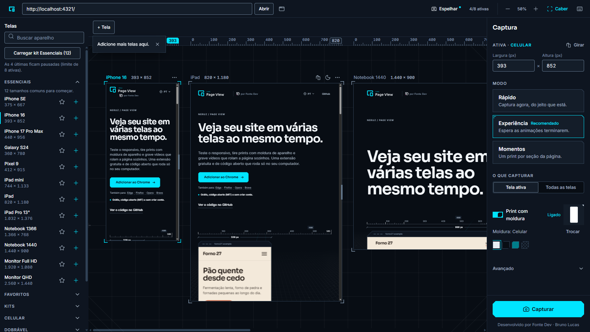

<p align="center">
  
</p>

<p align="center">
  <a href="LICENSE"></a>
  
  
  
</p>

<p align="center">
  <a href="https://pageview.neruz.tech"><b>Site</b></a> ·
  <a href="#instalar">Instalar</a> ·
  <a href="#como-funciona">Como funciona</a> ·
  <a href="#para-quem-é">Cenários</a> ·
  <a href="#privacidade-e-permissões">Privacidade</a> ·
  <a href="#desenvolvimento">Desenvolvimento</a>
</p>

---

**Neruz Page View** junta numa extensão só o que hoje pede três ou quatro: ver um site em vários tamanhos de tela lado a lado, navegar em todos ao mesmo tempo e sair com print, vídeo ou mockup pronto para mostrar ao cliente ou postar.

É **gratuita para sempre**, **código aberto (MIT)** e roda **100% no seu computador**. Sem conta, sem servidor e sem versão paga escondida.

<p align="center">
  
</p>

## Instalar

| Navegador            | Como                                                                                                                                                     |
| -------------------- | -------------------------------------------------------------------------------------------------------------------------------------------------------- |
| Chrome, Brave, Opera | Chrome Web Store (link em breve)                                                                                                                         |
| Edge                 | Edge Add-ons (em breve)                                                                                                                                  |
| Firefox 128+         | Firefox Add-ons (em breve)                                                                                                                               |
| Versão de teste      | Baixe o `.zip` em [Releases](../../releases), descompacte e carregue em `chrome://extensions` → **Modo do desenvolvedor** → **Carregar sem compactação** |

Depois de instalar, clique no ícone da extensão (ou `Alt+Shift+P`) para abrir o **Estúdio** com a página atual.

## Como funciona

1. **Abra o Estúdio** a partir de qualquer aba. A página aparece em um kit inicial de telas.
2. **Monte suas telas**: 46 aparelhos na biblioteca (celular, dobrável, tablet, notebook, desktop, TV), favoritos, kits salvos e telas com o tamanho que você quiser. Gire, redimensione arrastando, ajuste o zoom ou use **Caber**.
3. **Navegue em todas de uma vez**: com **Espelhar** ligado, rolagem, cliques, navegação e digitação feitos numa tela se repetem nas outras.
4. **Capture**:
   - **Print**: _Rápido_ (como está), _Experiência_ (espera as animações de scroll terminarem) ou _Momentos_ (um print por seção). Da tela ativa, de todas ou de várias páginas.
   - **Print com moldura**: o print sai dentro de uma moldura de aparelho com fundo escolhido. A moldura aparece ao vivo na tela ativa antes de capturar.
   - **Vídeo**: a página rola sozinha, pausa em cada seção e sai em vertical 1080×1920, quadrado, 16:9 ou no tamanho da tela. Uma mini barra controla pausa e velocidade durante a gravação.
   - **Várias páginas**: lista de URLs, sitemap ou links internos, em fila, com ZIP organizado e relatório HTML.
5. **Exporte** em PNG, JPEG, WebP, PDF, MP4, WebM, GIF ou ZIP.

## Para quem é

- **Dev front-end**: conferir o responsivo de uma vez, achar rolagem lateral (a extensão avisa) e testar `localhost`.
- **Designer**: revisar a hierarquia em vários tamanhos e gerar mockups sem abrir outro programa.
- **Agência e freelancer**: entregar ao cliente prints com moldura e um relatório de capturas de todas as páginas.
- **Social media e quem não é técnico**: transformar um site em vídeo vertical para Reels e Stories em dois cliques.

## Privacidade e permissões

Nada sai do seu computador. A extensão não tem servidor, não usa analytics e não coleta dados. Configurações ficam no armazenamento local do navegador. Política completa: [pt-BR](docs/PRIVACIDADE.md) · [en](docs/PRIVACIDADE.en.md) · [es](docs/PRIVACIDADE.es.md).

| Permissão                                  | Para quê                                                                                                        |
| ------------------------------------------ | --------------------------------------------------------------------------------------------------------------- |
| `activeTab`, `scripting`                   | Ler a página que você abriu no Estúdio e espelhar as ações entre as telas                                       |
| `declarativeNetRequestWithHostAccess`      | Permitir que sites apareçam dentro das telas do Estúdio. Vale só para as abas do Estúdio e é desfeito ao fechar |
| `storage`                                  | Guardar suas telas, kits e preferências localmente                                                              |
| `offscreen`                                | Gravar o vídeo em segundo plano (Chromium)                                                                      |
| Acesso a sites (opcional)                  | Pedido site a site, só quando você abre aquele site no Estúdio                                                  |
| `tabCapture`, `clipboardWrite` (opcionais) | Gravar vídeo e copiar o print, pedidos só no primeiro uso                                                       |

## Desenvolvimento

Requisitos: Node 22.23+ e pnpm 12.

```bash
pnpm install
pnpm dev:ext            # extensão em modo desenvolvimento (Chrome)
pnpm dev:landing        # site em http://localhost:4321
pnpm build:ext          # apps/page-view/.output/chrome-mv3
pnpm build:ext:firefox  # apps/page-view/.output/firefox-mv3
pnpm lint && pnpm typecheck && pnpm test
```

| Pasta              | Conteúdo                                               |
| ------------------ | ------------------------------------------------------ |
| `apps/page-view`   | Extensão (WXT, React, TypeScript)                      |
| `apps/landing`     | Site de apresentação (Astro)                           |
| `packages/core`    | Mensageria, armazenamento, fila de páginas e relatório |
| `packages/capture` | Captura de imagem e gravação de vídeo                  |
| `packages/devices` | Biblioteca de aparelhos                                |
| `packages/i18n`    | Traduções pt-BR, en, es                                |
| `packages/ui`      | Design tokens, molduras e componentes                  |

Arquitetura, contratos internos e decisões: [ARQUITETURA](docs/ARQUITETURA.md) · [API](docs/API.md) · [DECISÕES](docs/DECISOES.md) · [DESIGN SYSTEM](docs/DESIGN-SYSTEM.md).

## Contribuir

Issues e pull requests são bem-vindos. Antes de abrir um PR, rode `pnpm lint && pnpm typecheck && pnpm test`. Para mudanças grandes, abra uma issue primeiro para conversarmos.

## Licença

[MIT](LICENSE). Use, estude, modifique e distribua à vontade, inclusive em projetos comerciais, mantendo o aviso de copyright.

## Família Neruz

O Page View é a primeira extensão da **Neruz Extensions**, uma família de ferramentas para quem constrói na web. Mais em breve em [neruz.tech](https://neruz.tech).

---

<p align="center">
  Desenvolvido por <a href="https://fontedev.com"><b>Fonte Dev · Bruno Lucas</b></a>.<br>
  A Fonte Dev cria sites e experiências digitais sob medida. <a href="https://fontedev.com">Conheça o trabalho</a>.
</p>
